# walle-emoji

54 animated pixel-art robot emoji for Slack, Discord, or anywhere else that takes a small GIF.

Each one is 128×128 with a transparent background, loops forever, and is under 30 KB, so they all fit Slack's custom emoji limits as they are.

<table>
<tr><td align="center">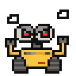<br><sub>angry</sub></td><td align="center">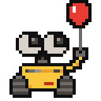<br><sub>balloon</sub></td><td align="center">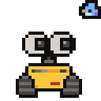<br><sub>bird</sub></td><td align="center">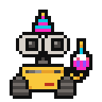<br><sub>birthday</sub></td><td align="center">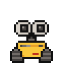<br><sub>bow</sub></td><td align="center"><br><sub>boxup</sub></td></tr>
<tr><td align="center"><br><sub>brb</sub></td><td align="center">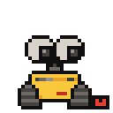<br><sub>bug</sub></td><td align="center">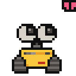<br><sub>butterfly</sub></td><td align="center">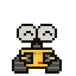<br><sub>clap</sub></td><td align="center">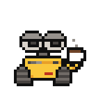<br><sub>coffee</sub></td><td align="center">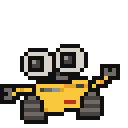<br><sub>dance</sub></td></tr>
<tr><td align="center">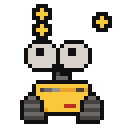<br><sub>dizzy</sub></td><td align="center">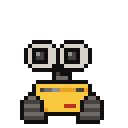<br><sub>eyes</sub></td><td align="center"><br><sub>facepalm</sub></td><td align="center">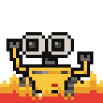<br><sub>fire</sub></td><td align="center">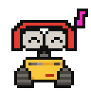<br><sub>headphones</sub></td><td align="center">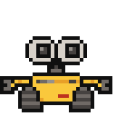<br><sub>highfive</sub></td></tr>
<tr><td align="center">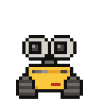<br><sub>lightbulb</sub></td><td align="center">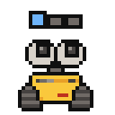<br><sub>loading</sub></td><td align="center">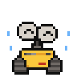<br><sub>lol</sub></td><td align="center">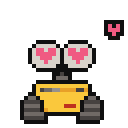<br><sub>love</sub></td><td align="center">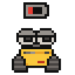<br><sub>lowbattery</sub></td><td align="center">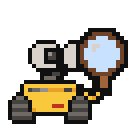<br><sub>magnify</sub></td></tr>
<tr><td align="center"><br><sub>mindblown</sub></td><td align="center">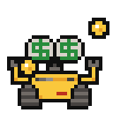<br><sub>money</sub></td><td align="center">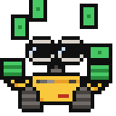<br><sub>money-makeitrain</sub></td><td align="center">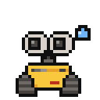<br><sub>nervous</sub></td><td align="center">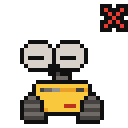<br><sub>no</sub></td><td align="center">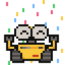<br><sub>party</sub></td></tr>
<tr><td align="center"><br><sub>peek</sub></td><td align="center">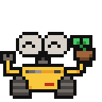<br><sub>plant-dance</sub></td><td align="center">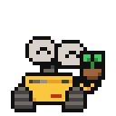<br><sub>plant-gift</sub></td><td align="center">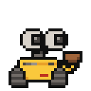<br><sub>plant-grow</sub></td><td align="center">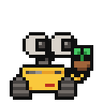<br><sub>plant-wilt</sub></td><td align="center">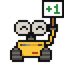<br><sub>plusone</sub></td></tr>
<tr><td align="center">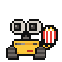<br><sub>popcorn</sub></td><td align="center">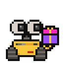<br><sub>present</sub></td><td align="center">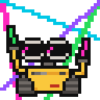<br><sub>rave</sub></td><td align="center">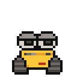<br><sub>sad</sub></td><td align="center"><br><sub>salute</sub></td><td align="center">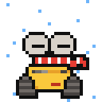<br><sub>scarf</sub></td></tr>
<tr><td align="center">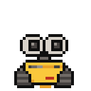<br><sub>shipit</sub></td><td align="center"><br><sub>shrug</sub></td><td align="center"><br><sub>shy</sub></td><td align="center">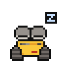<br><sub>sleep</sub></td><td align="center"><br><sub>sunglasses</sub></td><td align="center">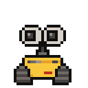<br><sub>thinking</sub></td></tr>
<tr><td align="center"><br><sub>trashcube</sub></td><td align="center">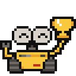<br><sub>trophy</sub></td><td align="center">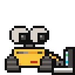<br><sub>typing</sub></td><td align="center">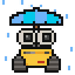<br><sub>umbrella</sub></td><td align="center">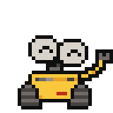<br><sub>wave</sub></td><td align="center">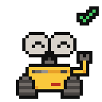<br><sub>yes</sub></td></tr>
</table>

## Download

- **Everything:** [`walle-emoji.zip`](walle-emoji.zip) contains all 54 GIFs.
- **One at a time:** each file is in [`gifs/`](gifs), named `walle-<name>.gif`.

## Add them to Slack

1. Open the emoji picker and choose **Add Emoji**.
2. Upload a GIF and give it a name, for example `walle-dance`.
3. Use it as `:walle-dance:` in a message or as a reaction.

Slack adds custom emoji one file at a time, and your workspace must allow members to add them.

## Regenerate the GIFs

Nothing here is hand-drawn in an image editor. [`generate.py`](generate.py) draws every frame on a 32×32 pixel grid, scales it up four times, and writes the GIFs. It needs Python 3 and [Pillow](https://pypi.org/project/pillow/).

```bash
pip install pillow
python generate.py gifs
```

To add an emoji, define its poses near the end of `generate.py` and pass them to `save` or `save2`.

## Licence and disclaimer

The code in this repository is released under the [MIT licence](LICENSE).

This is unofficial fan art. WALL-E is a character and trademark of Disney/Pixar. This project is not affiliated with, sponsored by, or endorsed by Disney or Pixar, and the MIT licence does not grant any rights to that character. The images are shared for personal, non-commercial use.
